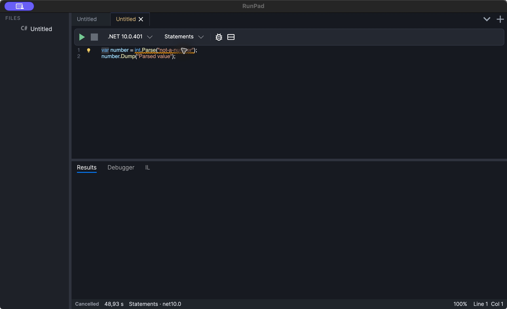

# Diagnostics and analyzers

While you edit a C# script, RunPad analyzes it in the background and underlines problems.
This page explains where those messages come from, how quick fixes work, and what the
analysis does not promise.

<figure markdown="span">
  [](assets/screenshots/diagnostics.png "Open full-size screenshot")
  <figcaption>A warning on a constant that cannot be parsed as an integer (RPAD0356). The downloadable example below demonstrates overflow warnings and a missing namespace.</figcaption>
</figure>

## Four kinds of analysis

| Source | IDs | Where you see it | When |
| --- | --- | --- | --- |
| C# compiler | `CS…` (for example `CS0103`) | Editor underlines; also printed in the Results tab when you run | While you type and on every run |
| Roslyn IDE analyzers | `IDE…` | Mostly as lightbulb suggestions; many have no underline | While you type |
| RunPad analyzers | `RPAD…` | Editor warning underlines | While you type |
| Assembly Explorer analysis | none | The Assembly Explorer's analysis pane | When you ask for it |

**Compiler diagnostics** are the same errors and warnings the build reports. In the
editor they appear about half a second after you stop typing. When you run, RunPad
prints every compiler diagnostic in the Results tab as
`(line,column): severity ID: message`, with line numbers counted in the code block. Any
error stops the run; warnings do not.

**Roslyn IDE analyzers** come from Microsoft's Roslyn features library, the same family
as the `IDE` suggestions in Visual Studio ("use `var`", "remove unnecessary using", …).
Most of them report at *hidden* severity, so there is no underline; they make a
lightbulb fix available on the caret's line instead.

**RunPad analyzers** are RunPad's own checks for common mistakes in scratch code. Many of
them flag calls with constant arguments that always throw, such as parsing a string that
is out of range for the target type. They report warnings with IDs that start with
`RPAD` and have no quick fixes of their own.

**Assembly Explorer analysis** is a different tool: it searches compiled assemblies for
code that uses, reads, assigns or implements a member. See
[Assembly Explorer](assembly-explorer.md#analyze).

!!! info "Live analysis is C# only"
    Visual Basic scripts have no live diagnostics. Their compiler errors appear in the
    Results tab when you run.

Hover over an underline to read its message. The tooltip shows the message text only;
the diagnostic ID is not shown in the editor.

## Example: an always-failing constant

Download [`analyzer-diagnostics.rpad`](examples/analyzer-diagnostics.rpad) and open it.
**It is meant to be read in the editor, not run.** The code block is:

```csharp
var settings = JsonSerializer.Serialize(new { Name = "RunPad", Version = 1 });
Console.WriteLine(settings);

var small = byte.Parse("300");
var large = int.Parse("3000000000");
Console.WriteLine($"{small} {large}");
```

What you see in the editor:

- **Line 1** has an error underline: `JsonSerializer` is not in scope because
  `System.Text.Json` is not imported. If you run now, the Results tab shows
  `(1,16): error CS0103: The name 'JsonSerializer' does not exist in the current context`
  and nothing runs.
- **Lines 4 and 5** have warning underlines from RunPad analyzer **RPAD0258**. Hovering
  shows, for example: *'byte.Parse(...)' always throws OverflowException at runtime —
  '300' is out of range for byte*.

RPAD0258 checks `Parse` on the integer types and `decimal`, and the matching
`Convert.ToXxx` methods, when the argument is a constant string of plain digits.
RPAD0258 does **not** flag `int.Parse("abc")`; a separate analyzer, **RPAD0356**, detects non-numeric constant strings that always throw `FormatException`, such as the call in the screenshot. Values read at run time are outside these constant checks.

### Applying the quick fix

1. Put the caret on line 1. A lightbulb appears in the gutter on that line.
2. Click the lightbulb. The menu lists the fixes for that line, grouped by kind, with
   `using System.Text.Json;` first.
3. Choose `using System.Text.Json;`.

RunPad adds `System.Text.Json` to the `namespaces:` list in the script's front matter
rather than inserting a `using` line into the code, and the error disappears. If you now
run the script, it prints `{"Name":"RunPad","Version":1}` and then stops with
`System.OverflowException` thrown by `byte.Parse("300")`, exactly as RPAD0258 warned.

## Quick fixes and the lightbulb

The lightbulb shows only on the line that holds the caret, and only when that line has
something to offer. Clicking it always opens a menu; nothing is applied without your
choice. Entries come from Roslyn's built-in code fix and refactoring providers, for
example:

- add a missing namespace (written to the front matter, as above);
- generate a missing variable or method;
- implement an interface or abstract class;
- refactorings offered at the caret position, such as conversions between equivalent
  forms of code.

Refactorings appear after the caret rests for a moment; fixes follow the background
analysis of your edits.

To add every missing namespace at once, use **Resolve All Usings** (++ctrl+alt+u++). It
adds the namespace for each unresolved type that has exactly one candidate.

## Settings

Open **Preferences → Languages → .NET → C#**:

| Setting | Effect |
| --- | --- |
| *Code fixes and refactorings (lightbulb)* | Turns the lightbulb on or off. Underlines are not affected. |
| *Excluded diagnostic IDs* | One ID per line, matched exactly and case-insensitively (for example `IDE0007`). Hides lightbulb fixes for those diagnostics. Underlines are not affected, and refactorings, which have no diagnostic ID, cannot be excluded this way. The default list contains `IDE0055` (formatting). |
| *Inlay hints* | Shows or hides inferred types next to `var` and `foreach` variables. |

## What analysis does not promise

- The analyzers find **specific** patterns. A clean editor does not mean the script is
  correct, and RunPad analyzers report only what they can prove from constants in the
  code.
- RunPad analyzer and IDE analyzer results are editor-only. They do not run during
  compilation, so they never stop a run and do not appear in the Results tab or in the
  [command-line runner](cli.md).
- Analysis runs after a short pause in typing, so underlines can lag behind very fast
  edits by a moment.
