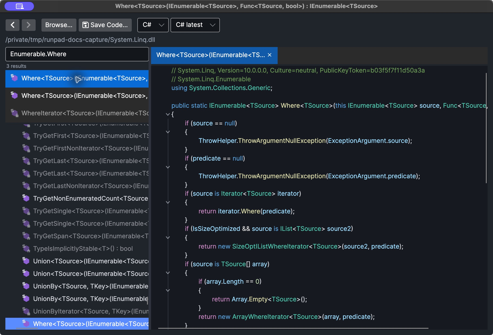

# Assembly Explorer

The Assembly Explorer shows the contents of compiled .NET assemblies: a tree of namespaces,
types and members on the left, and decompiled code on the right. It works like a small
ILSpy inside RunPad. There is one Assembly Explorer window per RunPad instance.

<figure markdown="span">
  
  <figcaption>Searching and reading a decompiled System.Linq method.</figcaption>
</figure>

## Opening it

- **Edit → Assembly Explorer...** opens it empty. Click **Browse...** to add an assembly,
  or drop `.dll`, `.exe` or `.winmd` files onto the window.
- **Go to Definition** (++f12++) on a symbol that is not declared in your C# script opens
  the explorer with that member decompiled, its assembly loaded and its row selected.
  Later ++f12++ jumps from the script open in a new tab of the same window.

## The tree

Each loaded assembly has:

- **References** — the assemblies it references. Double-click a reference or press
  ++enter++ to load that assembly too. References that cannot be found are marked as
  unavailable.
- **Resources** — its manifest resources, when it has any.
- One node per **namespace**, containing types. A type expands into *Base Types*,
  *Derived Types*, nested types and members. Non-public members are greyed.

Selecting a type shows the whole type; selecting a member shows only that member. Press
++delete++, or use **Remove assembly** in the context menu, to remove an assembly row.

## Reading code

The toolbar above the code has:

- **Back** and **Forward** (++alt+left++ / ++alt+right++, or the mouse's back and
  forward buttons);
- **Browse...** to add another assembly;
- **Save Code...** (++ctrl+s++) to save the code that is shown, as a `.cs` or `.il` file
  depending on the view;
- a **language** drop-down: **C#** (decompiled) or **IL**;
- a **C# version** drop-down, from *C# latest* down to *C# 2.0*, which limits the
  language features the decompiler may use.

The code pane is read-only. In the C# view, put the caret on a name and press ++f12++,
or hold ++ctrl++ and click it, to go to that type or member. Holding ++ctrl++ underlines
names you can navigate to. If the target is in another assembly, that assembly is added
to the tree. Navigation is available only in the C# view, not in IL.

### Tabs

Each tab has its own page and its own Back/Forward history.

- Open a tree row in a new tab with **Open in New Tab** in its context menu, a middle-click
  or ++ctrl++ + click.
- Switch tabs with ++ctrl+tab++ and ++ctrl+shift+tab++.
- Close a tab with its **×** button, a middle-click or ++ctrl+w++.

### Resources

Selecting an embedded resource shows its content as text. `.resources` files are listed
as `key = value` lines. Large resources are cut off after 4 MB. Linked (non-embedded)
resources are marked unavailable.

## Search

Type in *Search types and members* (++ctrl+shift+f++) to search every loaded assembly.
Results appear while the box has text. Press ++down++ to move into the results and
++escape++ to clear the box. Selecting a result opens it.

## Analyze

Right-click a type or member and choose one of the **Analyze:** entries, or press
++ctrl+r++ to run the first one. Results appear in the analysis pane under the tree;
selecting a result opens it.

| Selected item | Available analyses |
| --- | --- |
| Method or constructor | **Used By** (code that calls it), **Uses** (methods and fields its body refers to) |
| Property or event | **Used By** |
| Field | **Read By**, **Assigned By** |
| Class or struct | **Used By**, **Instantiated By**, **Exposed By** (members whose signatures mention it) |
| Interface | **Used By**, **Implemented By**, **Exposed By** |
| Enum or delegate | **Used By**, **Exposed By** |
| Virtual or abstract member | adds **Overridden By** |
| Interface member | adds **Implemented By** |

For **Used By** on a member, the **Include virtual calls** check box also counts calls
made through the base or interface members it overrides or implements, which may reach it
at run time.

!!! note "Analysis scope"
    Analysis reads only the assemblies currently loaded in the tree (**Uses** reads only
    the selected member's own body). To find callers in another assembly, load it first.
    Code the compiler generates for a member, such as lambdas, local functions and
    `async` or iterator state machines, is counted as part of that member. Overloads and
    generic members are matched by their full signatures, so results from one overload are
    not attributed to another.

## Keyboard reference

| Key | Action |
| --- | --- |
| ++f12++ / ++ctrl++ + click | Go to the definition under the caret or pointer (C# view) |
| ++alt+left++ / ++alt+right++ | Back / Forward |
| ++ctrl+shift+f++ | Focus the search box |
| ++ctrl+r++ | Run the first analysis for the selected row |
| ++ctrl+s++ | Save the shown code |
| ++ctrl+w++ | Close the current tab |
| ++ctrl+tab++ / ++ctrl+shift+tab++ | Next / previous tab |
| ++enter++ on a reference | Load the referenced assembly |
| ++delete++ on an assembly | Remove it from the tree |

These keys are fixed and use the Control key on every platform, including macOS.
