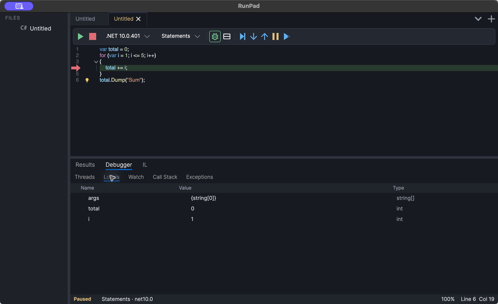

# Debugging

RunPad debugs C# and Visual Basic scripts with [netcoredbg](https://github.com/Samsung/netcoredbg),
an open-source .NET debugger, over the Debug Adapter Protocol. The setup window installs it
on first run, or you can point **Preferences → Languages → .NET → Debugger path** at an
existing `netcoredbg` executable. See [Installation](install.md#first-run-net-sdk-and-debugger).

<figure markdown="span">
  [](assets/screenshots/debugging.png "Open full-size screenshot")
  <figcaption>Execution paused inside a loop, with the current line and the variables total and i visible.</figcaption>
</figure>

## Start a debug session

1. Click the **bug** button in the toolbar (*Toggle debug mode*). It stays highlighted
   while debug mode is on.
2. Set at least one breakpoint (see below).
3. Press ++f5++ or click **Run**.

With debug mode on, Run starts the script under the debugger. With it off, Run starts the
script normally and breakpoints are ignored. The debug-only toolbar buttons (Step Over,
Step Into, Step Out, Pause and Run to Cursor) appear only while a session is running.

## Breakpoints

Click in the gutter, where the line numbers are, to add a breakpoint on that line. Click
it again to remove it. Breakpoints can be added and removed during a session; the
debugger receives the change the next time execution stops.

The gutter icon shows each breakpoint's state:

| Icon | Meaning |
| --- | --- |
| Filled circle | Set. Before the session starts, or until the debugger answers, it has not been checked yet. |
| Filled circle in the "verified" color | The debugger bound the breakpoint to code. |
| Hollow ring | The debugger rejected it, or the breakpoint is disabled. Hover over it to read the debugger's reason, for example that there is no code on that line. |
| Small diamond badge | The breakpoint has a condition or hit count. |

A breakpoint on a blank line, a comment or a line with only a brace usually ends up
unverified, because the compiler generated no code there. Move it to a line with a
statement.

### Conditions, hit counts and disabling

Right-click the gutter on a line to open the breakpoint dialog. It works for a line with
or without a breakpoint:

- **Enabled** — clear it to keep the breakpoint in the gutter without stopping there.
  Disabled breakpoints are not sent to the debugger.
- **Break when this condition is true** — an expression evaluated in the script's
  context, such as `i == 3`.
- **Break only when the hit count matches** — for example `= 5`, `>= 3` or `% 2`.

The condition and hit count are evaluated by netcoredbg.

## When execution is paused

The line about to run is highlighted and marked with an arrow in the gutter. The
**Debugger** tab under the editor has these panels:

| Panel | Contents |
| --- | --- |
| **Locals** | Variables in the current scope with name, value and type. Objects and collections expand on demand. |
| **Watch** | Expressions you add with **+ Add** and edit in the *Expression* column. They are re-evaluated every time execution stops. **− Remove** deletes the selected row. |
| **Call Stack** | The method, file and line of each frame. |
| **Threads** | ID and name of every thread in the script's process. |
| **Exceptions** | The exception break settings below. |

### Stepping

| Action | Default key | Toolbar |
| --- | --- | --- |
| Continue | ++f5++ | Run/Continue button |
| Step Over | ++f10++ | Step Over |
| Step Into | ++f11++ | Step Into |
| Step Out | ++shift+f11++ | Step Out |
| Pause | — | Pause |
| Run to Cursor | — | Run to Cursor (runs until the line that holds the caret) |
| Stop | ++escape++ | Stop |

The keys can be changed in **Preferences → Keyboard**; see
[Keyboard shortcuts](reference.md#keyboard-shortcuts). On macOS, function keys may need
the ++fn++ key depending on your keyboard settings.

### Breaking on exceptions

In **Debugger → Exceptions**:

- **Break on unhandled exceptions** pauses when an exception is about to end the script.
- **Break on all exceptions (including caught)** pauses whenever an exception is thrown,
  even if a `catch` handles it.

The settings apply to the next debug session.

## Practice script

Download [`debugging-loop.rpad`](examples/debugging-loop.rpad). Its code block is:

```csharp linenums="1"
var total = 0;
for (var i = 1; i <= 5; i++)
{
    var square = Square(i);
    total += square;
    Console.WriteLine($"i = {i}, square = {square}, running total = {total}");
}

total.Dump("Sum of squares 1..5");

int Square(int value)
{
    var result = value * value;
    return result;
}
```

Try this:

1. Turn debug mode on and click the gutter on line 4. Press ++f5++. Execution stops on
   line 4 with `i` = 1 in **Locals**.
2. Press ++f11++ to step into `Square`. Execution moves to line 13. Press ++shift+f11++
   to return.
3. Add the watch expression `total * 2` in **Watch**, then press ++f5++ a few times and
   watch it change.
4. Right-click the breakpoint, enter the condition `i == 3` and click **OK**. Stop with
   ++escape++ and run again: the first stop is now at `i` = 3.

Without a debugger the script prints five lines, from `i = 1, square = 1, running total = 1`
to `i = 5, square = 25, running total = 55`, and then a block **Sum of squares 1..5**
with the value 55.

## Limitations

- *Set Next Statement* is not available.
- `Util.ReadLine` and `Util.GetPassword` (see [interactive input](results.md#interactive-input))
  do not work while debugging. Use a normal run for interactive scripts.
- Debug mode needs a configured netcoredbg; without one, use normal runs.

## Troubleshooting

**Debugging does nothing or fails to start.** Check **Preferences → Languages → .NET →
Debugger path**. It must point to the `netcoredbg` executable itself
(`netcoredbg.exe` on Windows), and the file must exist. Restarting RunPad without a valid
path shows the setup window again, where **Install** downloads a matching build.

**The script runs, but breakpoints are ignored.** Make sure the bug button is
highlighted before you press Run. Without debug mode, breakpoints are not used.

**A breakpoint shows a hollow ring.** Hover over it to read the debugger's reason. Most
often the line has no executable code; move the breakpoint to a statement. Also check
that the breakpoint has not been disabled in its right-click dialog.

**No .NET SDK found.** See [Troubleshooting](reference.md#troubleshooting).
