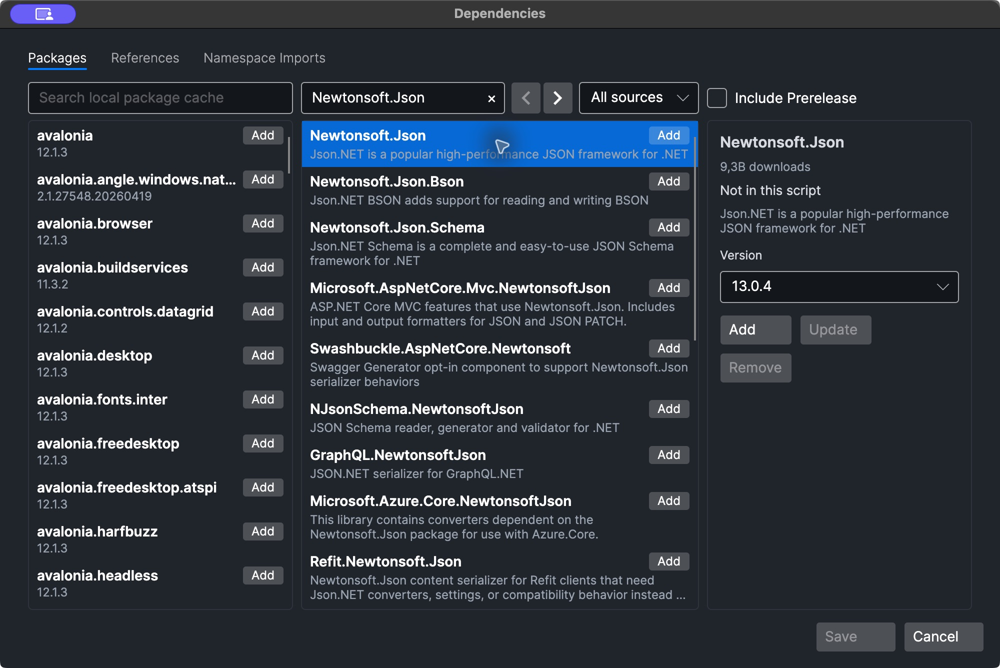

# Packages and references

A script's dependencies live in its front matter: `packages`, `references` and
`namespaces`. You can edit them in the **Dependencies** window instead of typing YAML.

<figure markdown="span">
  [](assets/screenshots/dependencies.png "Open full-size screenshot")
  <figcaption>The Dependencies window, Packages tab.</figcaption>
</figure>

## Open the Dependencies window

Choose **Edit → Dependencies** or press ++f4++. The window edits the script in the active
tab. It has three tabs, described below. Click **Save** to apply your changes to the
script, or **Cancel** to discard them. Saving updates the front matter, writes the file if
it already has a name, and refreshes IntelliSense so new types are recognized.

## NuGet packages

The **Packages** tab has three columns, in the style of LINQPad's NuGet manager:

- **Left** — the packages already in this script, followed by the packages in your local
  NuGet cache. Type in *Search local package cache* to filter them.
- **Middle** — online search. Type in *Search online*; search runs after a short pause, or press Enter to search immediately. Use the arrows to page through
  results, and pick a source in the drop-down: *All sources*, one enabled source, or
  *(configure sources...)*.
- **Right** — *Include Prerelease*, and details of the selected package with a
  **Version** list.

Select a package and a version, then:

- **Add** puts the package in the script;
- **Update** changes the version of a package the script already uses;
- **Remove** takes it out of the script.

The rows in the lists also have **Add**, **Update** and **Remove** buttons for the
common cases. A mark next to a package shows that it is already in this script.

In the file, packages are stored as `PackageId: version` pairs:

```yaml
packages:
  Humanizer.Core: 2.14.1
```

When you run the script, RunPad restores the packages itself (no `dotnet restore`
command is involved) and caches the result, so later runs with the same packages and code
skip the restore and compile steps. Restoring a package that is not in your local cache
needs access to its package source.

### Package sources

Choose *(configure sources...)* in the source drop-down to open **NuGet Package
Sources**. There you can add, remove and reorder sources (**Move to Top**, **Move Up**,
**Move Down**), enable or disable each one, and set:

- **Name** and **Source** — a feed URL such as `https://example.com/nuget/v3/index.json`,
  or a local folder (use the **...** button);
- **Authentication** — *None*, or *Basic* with a username and a password or personal
  access token.

These sources are used both for search and for restoring every script. RunPad keeps them
in its own `NuGet.Config` in its data folder, created the first time from your effective
NuGet settings. Your global NuGet settings are not changed. See
[Where RunPad stores data](reference.md#where-runpad-stores-data).

## Assembly references

The **References** tab lists `.dll` files the script references. Type a path in
*Path to a .dll* or use **Browse…**, then click **Add**. **Remove** takes a reference
out.

```yaml
references:
  - C:\Tools\MyCompany.Utilities.dll
  - $(CurrentQueryPath)/lib/Helpers.dll
```

- Only paths ending in `.dll` are used as assembly references.
- Other `.dll` files in the same folder that the referenced assembly depends on are
  picked up automatically.
- A path whose file does not exist is skipped, so the script then fails to compile with
  errors about the missing types. Prefer absolute paths or the macros below; a plain
  relative path is not resolved against the script's folder.

These macros are expanded in reference paths, in RunPad and in the command-line runner:

| Macro | Expands to |
| --- | --- |
| `$(CurrentQueryPath)` | The folder that contains the running `.rpad` file. Not expanded for an unsaved tab. |
| `$(MyDocuments)` | Your Documents folder. |
| `$(RuntimeDirectory)` | The folder of the .NET runtime that RunPad itself runs on. |

### Project references are not supported

RunPad compiles scripts in-process with Roslyn and does not use MSBuild, so a script
cannot reference a `.csproj` or `.vbproj`. If `references` contains one, the run stops
with:

```text
Project references are no longer supported: MyLibrary.csproj. Reference the project's built .dll instead.
```

Build the project with your usual tools and reference the resulting `.dll` instead.

## Namespace imports

The **Namespace Imports** tab is a text box with one namespace per line, for example
`System.Text.Json`. These namespaces are imported for the whole script: as global
`using` directives in C#, or project-level `Imports` in Visual Basic. They are stored in
`namespaces` in the front matter.

You rarely need to type them yourself: accepting a completion item for a type from
another namespace, a `using …;` [quick fix](analyzers.md#quick-fixes-and-the-lightbulb)
and **Resolve All Usings** (++ctrl+alt+u++) all add namespaces here. The default
namespaces listed in [Scripts and .rpad files](scripts.md#namespaces-imported-by-default)
are always imported and do not need to be added.
