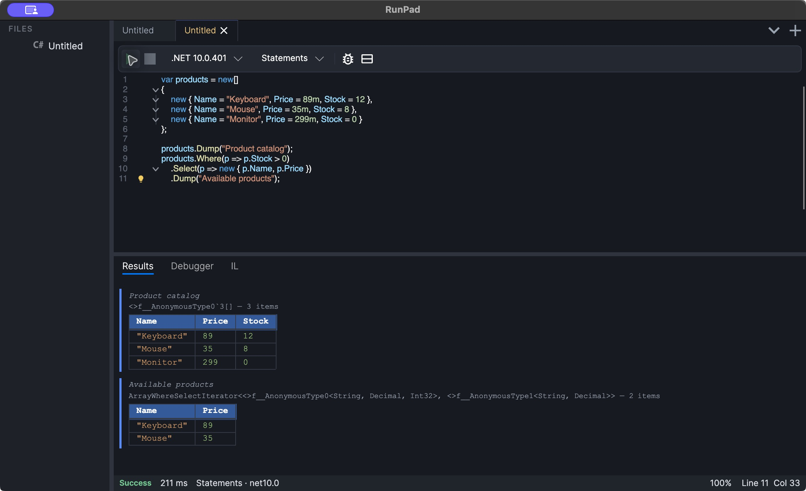

# RunPad

RunPad is a desktop scratchpad for small C# and Visual Basic programs, in the same
space as LINQPad, RoslynPad and NetPad. Each script is a `.rpad` file: a Markdown
document with a short YAML header and one runnable code block. RunPad compiles the
block with the .NET SDK installed on your machine, runs it, and shows the output and
any `.Dump()` results under the editor.

<figure markdown="span">
  
  <figcaption>The main window: file tree, editor, toolbar and Results tab.</figcaption>
</figure>

Click a screenshot to open it at full size.

## Start here

1. [Install RunPad](install.md) and let the first-run setup find or install the .NET
   SDK and the `netcoredbg` debugger.
2. Follow the [quick start](quick-start.md) to run your first script and read its
   output.
3. Download the [examples](examples.md) to try the features described in this guide.

## What you can do

- **Run scripts** in three styles (*kinds*): top-level statements, a `Main` program, or a
  single expression. See [Scripts and .rpad files](scripts.md).
- **Write C# with IntelliSense**: completion with automatic imports, signature help,
  quick info, semantic highlighting, rename, Go to Definition and formatting. See
  [Editor](editor.md).
- **See problems while you type**: compiler errors, Roslyn IDE analyzers, RunPad's own
  analyzers and lightbulb quick fixes. See [Diagnostics and analyzers](analyzers.md).
- **Debug** with breakpoints (including conditions and hit counts), stepping, locals,
  watches, call stack, threads and exception breaks. See [Debugging](debugging.md).
- **Inspect results** with `.Dump()` tables, live-updating `DumpContainer` blocks,
  progress bars and interactive input. See [Results and runtime helpers](results.md).
- **Add NuGet packages, assembly references and namespaces** in the Dependencies
  window. See [Packages and references](dependencies.md).
- **Browse compiled code** in the Assembly Explorer: decompiled C#, IL, resources and
  usage analysis. See [Assembly Explorer](assembly-explorer.md).
- **Run scripts from a terminal** and convert LINQPad queries. See
  [Command line and LINQPad import](cli.md).

## C# and Visual Basic

Both languages compile, run and debug the same way. Editor intelligence currently
exists only for C#.

| Capability | C# | Visual Basic |
| --- | --- | --- |
| Run, kinds (Statements, Program, Expression) | Yes | Yes |
| Debugger (breakpoints, stepping, locals, watches) | Yes | Yes |
| NuGet packages, assembly references, namespaces | Yes | Yes |
| `.Dump()` and the RunPad runtime helpers | Yes | Yes |
| Syntax highlighting, brace matching, folding | Yes | Yes (keyword-based folding) |
| Completion, signature help, quick info | Yes | No |
| Live diagnostics, analyzers, quick fixes | Yes | No (errors appear when you run) |
| Semantic highlighting, inlay hints | Yes | No |
| Rename, Find References, Go to Definition, Format Document | Yes | No |
| Snippets | Yes | No |

## What RunPad does not do (yet)

- Scripts cannot reference `.csproj` or `.vbproj` projects; reference a built `.dll`
  instead. See [Packages and references](dependencies.md#project-references-are-not-supported).
- There is no *Set Next Statement* in the debugger.
- There is no File → Open command. RunPad shows the `.rpad` files in its scripts folder;
  see [Where your scripts live](scripts.md#where-your-scripts-live).
- The macOS build is not signed or notarized with an Apple Developer certificate yet. See [Installation](install.md#macos).
