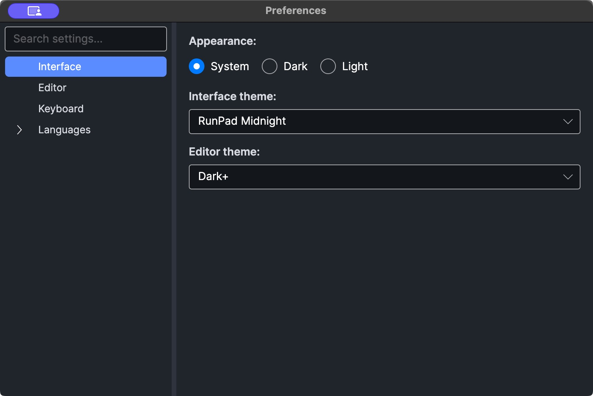

# Settings, shortcuts and troubleshooting

## Preferences

Open **Edit → Preferences** (shown as **Settings…** in the native macOS menu). Settings are grouped in a tree on the left; type in
*Search settings...* to filter it. Changes apply immediately.

<figure markdown="span">
  
  <figcaption>Preferences, with the Interface settings page selected.</figcaption>
</figure>

| Page | Settings |
| --- | --- |
| **Interface** | *Appearance*: System, Dark or Light. *Interface theme* and *Editor theme* for the current appearance (defaults: *VS Code Dark* / *VS Code Light* and *Dark+* / *Light+*). |
| **Editor** | Show line numbers, code folding, tabs, spaces, end of line, column ruler (column 80); word wrap; *Accept completion when typing punctuation*; font size and font family; *New file defaults (Ctrl+N)*: language and kind. |
| **Keyboard** | Key bindings; see [Keyboard shortcuts](#keyboard-shortcuts). |
| **Languages → .NET** | *Dotnet path* (default `dotnet`, found on `PATH`) and *Debugger path* (the `netcoredbg` executable). Shared by C# and Visual Basic. |
| **Languages → .NET → C#** | *Inlay hints*; *Code fixes and refactorings (lightbulb)*; *Excluded diagnostic IDs*. See [Diagnostics and analyzers](analyzers.md#settings). |
| **Languages → .NET → Visual Basic** | No settings yet. |

## Keyboard shortcuts

!!! warning "macOS uses the Control key"
    RunPad's shortcuts currently use the Control key (⌃) on every platform. On macOS,
    ++ctrl+s++ means Control-S, not Command-S. Some built-in text-editing commands in the
    editor follow the platform's own conventions.

### Customizable shortcuts

Change these in **Preferences → Keyboard**. Type a gesture such as `Ctrl+Shift+R` or
`F6`; it is applied when the field loses focus.

| Action | Default |
| --- | --- |
| Run / Continue | ++f5++ |
| Cancel (stop the run) | ++escape++ |
| Step Over | ++f10++ |
| Step In | ++f11++ |
| Step Out | ++shift+f11++ |
| Format Document | ++shift+alt+f++ |
| Go to Line | ++ctrl+g++ |
| Open Dependencies | ++f4++ |
| Close Tab | ++ctrl+w++ |
| Rename File (file tree) | ++f2++ |
| Delete File (file tree) | ++delete++ |
| New File | ++ctrl+n++ |
| Save As | ++ctrl+shift+s++ |
| Resolve All Usings | ++ctrl+alt+u++ |
| Save | ++ctrl+s++ (not shown in the Preferences window; stored as `Keyboard.Save` in `settings.json`) |

### Fixed editor shortcuts

| Action | Key |
| --- | --- |
| Open completion | ++ctrl+space++ |
| Signature help | ++ctrl+shift+space++ |
| Expand snippet | ++tab++ after a snippet keyword |
| Jump to matching brace | ++ctrl+bracket-right++ |
| Rename symbol | ++f2++ (in the editor) |
| Go to Definition / Implementation | ++f12++ |
| Find References | ++shift+f12++ |
| Zoom | ++ctrl++ + mouse wheel |

The Assembly Explorer has its own fixed keys; see
[Assembly Explorer](assembly-explorer.md#keyboard-reference).

## Where RunPad stores data

| What | Location |
| --- | --- |
| Your scripts | `RunPad Queries` in your Documents folder |
| Settings | `settings.json` in RunPad's data folder |
| NuGet sources | `NuGet.Config` in RunPad's data folder |
| Debugger installed by the setup window | `netcoredbg` folder in RunPad's data folder |
| Files written by `Util.Cache` and `Util.SaveString`/`SaveBytes` | `UserData` folder in RunPad's data folder |
| Logs | `logs` folder in RunPad's data folder |
| Build output | `RunPad` folder in the system temporary folder. A saved script keeps its build folder between runs; folders unused for 14 days are removed when RunPad starts. |

RunPad's data folder is:

| System | Folder |
| --- | --- |
| Windows | `%APPDATA%\RunPad` |
| macOS | `~/Library/Application Support/RunPad` |
| Linux | `~/.config/RunPad` (or `$XDG_CONFIG_HOME/RunPad`) |

## Troubleshooting

### No .NET SDK found

Symptoms: the setup window shows ❌ next to *.NET SDK*, the SDK drop-down in the toolbar
is empty and Run does nothing, or the command-line runner prints
`No .NET SDK found (checked dotnet --list-sdks).`

- Run `dotnet --list-sdks` in a terminal. RunPad needs at least one SDK of version 6 or
  newer.
- If the SDK is installed but not on `PATH` for desktop apps (common when RunPad is
  started from the macOS Dock or Finder), set the full path in
  **Preferences → Languages → .NET → Dotnet path**, for example
  `/usr/local/share/dotnet/dotnet` on macOS or `C:\Program Files\dotnet\dotnet.exe` on
  Windows.
- Or restart RunPad and use **Install** in the setup window.

### The debugger does not start or breakpoints are ignored

See [Debugging → Troubleshooting](debugging.md#troubleshooting).

### "Invalid document"

The file is not a valid `.rpad` document: the front matter is missing or not closed, the
YAML is invalid, a `kind` or `language` value is not supported, or there is no run block
for the declared language. The Results tab explains which. See
[Scripts and .rpad files](scripts.md#front-matter).

### A package cannot be restored

Check the package ID and version, and that a source in
[Package sources](dependencies.md#package-sources) has the package and is reachable.
Restore warnings and errors are printed in the Results tab.

### `Project references are no longer supported`

Reference the project's built `.dll` instead. See
[Project references are not supported](dependencies.md#project-references-are-not-supported).

### macOS refuses to open RunPad

The build is not signed or notarized yet. See [Installation → macOS](install.md#macos).

### No completion or underlines

These features exist only for C#. Check the `language` of the script; Visual Basic has
no live analysis yet. For C#, give the background analysis a moment after typing, and
check that the file is a valid document.
